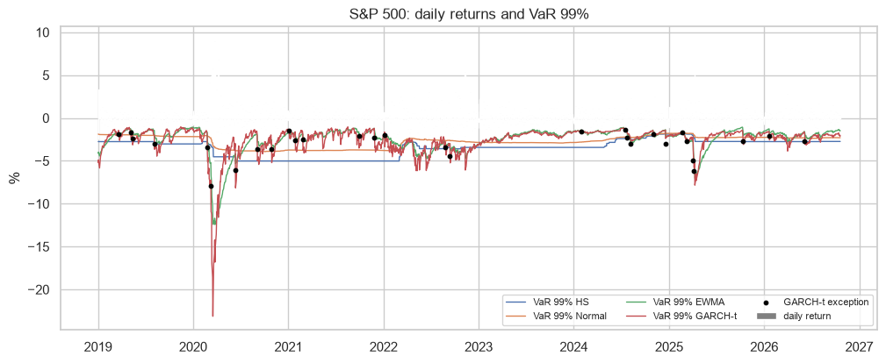
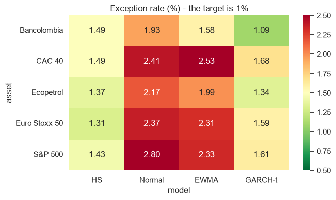

# Market risk: VaR and Expected Shortfall backtesting

I compare four models of 1-day VaR at 99% (historical simulation, normal, EWMA and GARCH(1,1) with Student-t) on the S&P 500, CAC 40, Euro Stoxx 50 and two Colombian stocks (Ecopetrol and Bancolombia ADRs), and I backtest them with Kupiec, Christoffersen and the Basel traffic light.

## Data
Daily adjusted prices from Yahoo Finance, 2012 to today.

## What I did
- Checked the normality of the returns (QQ plots, kurtosis)
- Rolling window of 500 days, one-day-ahead VaR and ES for each model
- Kupiec (number of exceptions), Christoffersen (independence) and Basel zones
- Compared the real loss on the exception days with the predicted ES

## Main results
- All series have fat tails (excess kurtosis between 9 and 17), and the normal VaR fails everywhere: between 1.9% and 2.8% of exceptions instead of 1%.
- Historical simulation gets the closest number of exceptions on the indices, but the exceptions come in clusters.
- GARCH-t is the only model that passes Kupiec and Christoffersen for both Colombian stocks, and its ES matches the real losses (ratio 1.01 to 1.10).




## How to run

```
pip install -r requirements.txt
jupyter notebook var_backtesting.ipynb
```

---
Alejandro Lezcano Osorio | Universidad EIA (Colombia) and Rennes School of Business (France)
